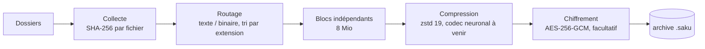
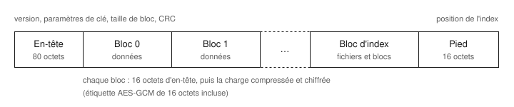

<h1 align="center">Saku</h1>

<p align="center">
  <strong>Un archiveur libre qui compresse puis chiffre.</strong><br>
  Un format documenté octet par octet, un lecteur qui se méfie de tout ce qu'il lit,<br>
  et des chiffres qui sortent d'une mesure, jamais d'une promesse.
</p>

<p align="center">
  <a href="https://github.com/Dimitri-Rey/SAKU/actions/workflows/ci.yml"></a>
  
  
  <a href="LICENSE"></a>
</p>

<p align="center">
  <a href="#démarrage-rapide">Démarrage rapide</a> ·
  <a href="#comment-ça-marche">Comment ça marche</a> ·
  <a href="#mesures">Mesures</a> ·
  <a href="#feuille-de-route">Feuille de route</a> ·
  <a href="docs/FORMAT-v0.md">Spécification</a>
</p>

---

## Pourquoi Saku

Les meilleurs compresseurs de texte au monde sont des modèles de langage : un modèle qui
prédit bien le caractère suivant permet de le coder en très peu de bits. Ils battent zstd et
xz de loin, et pourtant personne ne s'en sert pour archiver ses fichiers. Trois raisons :

1. **Ils ne sont pas reproductibles.** En virgule flottante, les probabilités changent d'un
   processeur à l'autre ; un seul bit d'écart et l'archive est illisible.
2. **Le modèle pèse plus lourd que ce qu'il fait gagner**, sauf sur d'énormes volumes.
3. **Ils sont lents**, souvent quelques kilooctets par seconde.

Saku veut lever ces trois verrous, dans cet ordre, pour le code source et le texte, avec un
codec neuronal **en arithmétique entière**, sans perte, et un conteneur sérieux autour :
chiffrement authentifié, accès direct aux fichiers, lecteur durci.

> [!IMPORTANT]
> **État actuel : prototype 0.1.0.** Le conteneur, le chiffrement, les tests et le banc de
> mesure sont en place. Le codec neuronal n'est pas encore écrit : Saku compresse
> aujourd'hui avec zstd, donc **il ne fait pas mieux que zstd**. Le format peut encore
> changer : ne confiez pas à Saku la seule copie d'un fichier.

### Ce que Saku ne promettra jamais

- **Un ratio universel.** Réduire n'importe quel gigaoctet à un mégaoctet est impossible :
  il n'existe pas assez de petits fichiers pour représenter tous les gros. Des données déjà
  compressées ou aléatoires ne rétrécissent pas.
- **Un chiffre sans mesure.** Chaque résultat est vérifié par un aller-retour octet pour octet,
  et la taille du modèle compte dans le ratio.
- **Du génératif sur du texte ou des chiffres.** Sans perte par défaut, toujours.

## Démarrage rapide

Il faut Linux ou macOS, [Python 3.14](https://www.python.org/downloads/) ou plus récent et
[uv](https://docs.astral.sh/uv/).

```bash
git clone https://github.com/Dimitri-Rey/SAKU.git
cd SAKU
uv sync
```

```bash
uv run saku creer projet.saku mon-projet/              # compresser
uv run saku creer --chiffrer coffre.saku mon-projet/   # compresser puis chiffrer
uv run saku lister projet.saku                         # voir le contenu
uv run saku verifier projet.saku                       # tout relire et tout contrôler
uv run saku extraire projet.saku -C sortie/            # tout extraire
uv run saku extraire projet.saku -C sortie/ mon-projet/src/main.py   # un seul fichier
```

La phrase de passe est demandée au clavier, ou lue dans `SAKU_MOT_DE_PASSE`. Elle ne se passe
jamais en argument : elle resterait dans l'historique du shell et dans la liste des processus.

<details>
<summary><strong>Depuis Python</strong></summary>

```python
from saku import Archive, creer_archive

creer_archive("projet.saku", ["mon-projet"], mot_de_passe="phrase longue et unique")

with Archive.ouvrir("projet.saku", "phrase longue et unique") as archive:
    for fichier in archive.fichiers:
        print(fichier.taille, fichier.chemin)
    contenu = archive.lire("mon-projet/README.md")   # ne déchiffre que les blocs utiles
    archive.verifier()                               # lève une erreur à la moindre anomalie
```

</details>

## Comment ça marche



1. **Collecte.** Les dossiers sont parcourus sans suivre les liens symboliques ; chaque fichier
   reçoit une empreinte SHA-256 qui servira à contrôler l'extraction.
2. **Routage.** Les fichiers sont classés en texte ou en binaire, puis rangés par extension et
   par chemin : les contenus qui se ressemblent deviennent voisins.
3. **Blocs.** Le tout forme un seul flux, coupé en blocs indépendants de 8 Mio. Un bloc ne
   mélange jamais texte et binaire, et chacun se lit seul : c'est ce qui donne l'accès direct.
4. **Compression.** zstd niveau 19 aujourd'hui ; le bloc est stocké tel quel si rien n'est à
   gagner. Le codec neuronal prendra cette place.
5. **Chiffrement.** On compresse d'abord, on chiffre ensuite : des données chiffrées ne se
   compressent plus.
6. **Index.** La liste des fichiers et des blocs est écrite à la fin, compressée et chiffrée
   elle aussi.

### Le format

<p align="center"></p>

Le lecteur commence par la fin : le pied indique où se trouve l'index, l'index dit où se trouve
chaque bloc et quel fichier occupe quelle partie du flux. Chaque champ, chaque borne et chaque
cas de rejet sont décrits dans [**FORMAT-v0.md**](docs/FORMAT-v0.md), qui doit suffire à écrire
un autre lecteur sans lire le code.

### Le chiffrement

Aucun algorithme maison : tout vient de la bibliothèque
[`cryptography`](https://cryptography.io/).

| Élément | Choix |
|---|---|
| Dérivation de clé | Argon2id, sel aléatoire par archive (3 passes, 256 Mio, 4 voies) |
| Chiffrement | AES-256-GCM, une étiquette d'authentification de 16 octets par bloc |
| Nonce | numéro du bloc : deux blocs échangés ou recopiés ne se déchiffrent plus |
| Données associées | empreinte de l'en-tête : modifier un paramètre invalide tous les blocs |
| Ce qui reste visible | la taille de l'archive, le nombre de blocs et la taille de chacun |

### Un lecteur méfiant

Une archive peut venir de n'importe qui. Saku la traite comme hostile :

- chaque taille annoncée est bornée **avant** toute allocation : pas de bombe de décompression ;
- chemins absolus, `..`, doublons et liens symboliques déjà présents sont refusés ;
- chaque fichier est écrit sous un nom temporaire, son SHA-256 est vérifié, puis il est mis en
  place ;
- toute anomalie produit une erreur claire, jamais un contenu partiel présenté comme bon.

La suite de tests inverse un bit à environ 3 000 positions de l'archive, la tronque à autant de
longueurs et truque son index : l'archive doit être refusée, ou rendre exactement l'original.

## Mesures

Sources de **CPython 3.14.0** (5 045 fichiers, 112 691 061 octets), un seul fil, sur processeur
seul. Chaque ligne est vérifiée par un aller-retour octet pour octet.

| Outil | Archive (octets) | bits/octet | Ratio | Compression | Décompression |
|---|---:|---:|---:|---:|---:|
| `xz -9` | 22 909 784 | 1,626 | 4,92 | 2,1 Mo/s | 101,9 Mo/s |
| `zstd --ultra -22 --long=27` | 23 200 760 | 1,647 | 4,86 | 1,4 Mo/s | 425,3 Mo/s |
| `zstd -19` | 23 971 699 | 1,702 | 4,70 | 2,1 Mo/s | 649,7 Mo/s |
| **Saku 0.1.0** | **24 384 040** | **1,731** | **4,62** | **2,5 Mo/s** | **45,1 Mo/s** |
| **Saku 0.1.0, chiffré** | **24 384 168** | **1,731** | **4,62** | **2,6 Mo/s** | **35,9 Mo/s** |

Ce que ça montre, sans enjoliver : Saku est aujourd'hui **1,7 % derrière `zstd -19`** et
**6,4 % derrière `xz -9`**. L'écart vient de l'index (une empreinte par fichier) et du découpage
en blocs indépendants. Chiffrer coûte **128 octets**. L'extraction est lente, car Saku écrit et
contrôle chaque fichier en Python là où les autres ne restituent qu'un tar.

Protocole, machine, second corpus, mémoire consommée, cmix et ts_zip :
[**docs/BENCHMARK.md**](docs/BENCHMARK.md).

## Feuille de route

- [x] Format v0, conteneur, chiffrement authentifié
- [x] Lecteur durci et tests d'archives hostiles
- [x] Banc de mesure vérifié contre zstd, xz, cmix et ts_zip
- [ ] **Codec neuronal sans perte en arithmétique entière** — le cœur du projet
- [ ] Reproductibilité prouvée entre machines et architectures (x86-64, ARM64)
- [ ] Conteneurs déjà compressés (.docx, .zip, JPEG) déballés et reconstruits à l'identique
- [ ] Correction d'erreurs, clé enveloppée, ajout de fichiers
- [ ] Mode avec perte pour les médias, **uniquement sur demande explicite**

Si le codec neuronal ne bat pas xz et zstd, modèle compris et à un débit supportable, Saku
n'a pas de raison d'exister. Les conditions d'abandon sont écrites à l'avance dans
[**docs/RISQUES.md**](docs/RISQUES.md).

## Le dépôt

```
src/saku/      la bibliothèque et la commande saku
tests/         91 tests, dont les archives hostiles
bench/         le banc de mesure (corpus et outils externes non versionnés)
docs/          spécification du format, mesures, risques, décisions (adr/)
site/          page de présentation statique
prompts/       prompts versionnés pour le modèle local qui a écrit une partie du code
outils/        pilotage du modèle local, génération du rapport de mesures
```

Une partie du code et des tests a été écrite par un modèle local (Qwen), piloté par les prompts
de [`prompts/`](prompts/), puis relue et corrigée. Le lecteur et l'écrivain d'archive sont écrits
à la main.

## Contribuer

```bash
uv run pytest -q       # tests
uv run ruff check .    # lint
uv run ruff format .   # mise en forme
```

Les règles du projet tiennent en peu de lignes :

- mesurer avant d'affirmer, et compter le modèle dans le ratio ;
- traiter toute archive comme hostile ;
- ne jamais inventer d'algorithme de chiffrement, ni chiffrer avant de compresser ;
- pas de virgule flottante dans un codec sans perte ;
- pas de mode avec perte par défaut, jamais sur du texte ou des chiffres.

Voir [CONTRIBUTING.md](CONTRIBUTING.md) et le [journal des modifications](CHANGELOG.md).

## Licence

[MIT](LICENSE) © 2026 Dimitri Rey
